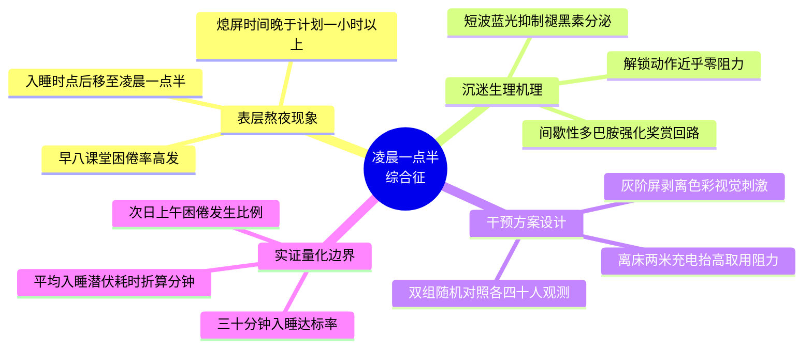

# 《“凌晨一点半综合征”：睡前短视频沉迷机制与大学生断网干预对照实验》大纲与段落契约规约

> **📌 分步构建说明（本文件由你在【任务一】和【任务二】中分两步增量完成）**：
> 1. **【任务一（00~10 min）填写前半部分】**：确立一句核心题眼填入 **“一、核心论点”**，向 AI 发送任务一 ROCA 提示词生成 Mermaid `mindmap` 思维导图，人工审视剪枝后粘贴至 **“二、发散思维导图”** 并保存；
> 2. **【任务二（10~25 min）追加后半部分】**：向 AI 发送任务二 ROCA 提示词，将上述思维导图拓扑投影为四章大纲并细化第 3 章数据槽位，追加粘贴至 **“三、拓扑排序四章制树状大纲”** 与 **“四、第 3 章段落级写作规约”** 并保存，合成完整的 `outline_spec.md`；
> 3. **【对照自检与断点兜底】**：完成任务二后，可打开 `../01_stage1_2_spec/outline_spec.md` 标准参考范例进行对照自检（若前两步调试耗时过长，也可直接复制该参考范例以保证顺利进入【任务三】）。

---

## 一、核心论点（Thesis Statement）——【任务一填写】

- **课题模式**：默认统一主线课题（或填写你的开放自选课题名称）
- **一句式核心论点**：睡前开启手机灰阶模式并执行离床两米充电隔离，能够阻断短视频多巴胺唤醒回路，从而显著缩短大学生入睡潜伏期并提升 30 分钟入睡达标率。

---

## 二、发散思维导图（Mermaid Mindmap）——【任务一填写】

---

## 三、拓扑排序四章制树状大纲（Hierarchical Outline）——【任务二追加】

- **第 1 章 凌晨一点半：睡前短视频沉迷的现象刻画**
  - 1.1 入睡时点后移的时间侵占特征
  - 1.2 早八困倦与周末被动补觉的连锁表现
- **第 2 章 从多巴胺到无意识解锁：沉迷的生理与行为机理**
  - 2.1 间歇性多巴胺强化与蓝光抑制褪黑素
  - 2.2 低阻力解锁动作链与干预靶点推导
- **第 3 章 灰阶屏与离床隔离：断网干预的双组对照实证**
  - 3.1 实验设置与核心睡眠指标基准对比
  - 3.2 干预效能对比与行为阻断机理
  - 3.3 日间精力恢复效应与早八课堂出勤质量验证
- **第 4 章 讨论、适用边界与结论**
  - 4.1 干预有效性的机理归因与推广边界
  - 4.2 研究局限与后续验证方向

---

## 四、第 3 章段落级写作规约（Paragraph Specification & Data Slots）——【任务二完成】

> **契约红线**：以下规约仅供【任务三：受控扩写】时结合 `raw_data.json` 注入真实数值，本阶段**严禁填入具体数字或提前写出完整正文**。

### 3.1 实验设置与核心睡眠指标基准对比（段落契约）

- **【目标字数区间】**：120~160 字
- **【核心论证功能】**：交代随机分组方式、样本规模、观测周期与"30 分钟入睡"达标口径，并以三线表给出两组基准指标，为后文对比建立坐标系。
- **【首尾过渡句方向】**：首句承接第 2 章机理结论引出实证需求；尾句以"基准差异是否成立"引出 3.2 的效能对比。
- **【数据槽位声明】**：`[待填槽位：样本量 N]`、`[待填槽位：分组方式]`、`[待填槽位：观测周期]`、`[待填槽位：达标率_对照组]`、`[待填槽位：达标率_干预组]`、`[待填槽位：平均入睡潜伏耗时_对照组（分钟）]`、`[待填槽位：平均入睡潜伏耗时_干预组（分钟）]`

### 3.2 干预效能对比与行为阻断机理（段落契约）

- **【目标字数区间】**：180~220 字
- **【核心论证功能】**：给出两组入睡潜伏耗时的绝对差与缩短率，并按"灰阶屏剥离色彩刺激 + 离床隔离抬高取用阻力 → 打断无意识解锁 → 缩短入睡潜伏期"的链条补全因果推演。
- **【首尾过渡句方向】**：首句承接 3.1 基准表；尾句以"次日功能状态是否同步改善"过渡到 3.3。
- **【数据槽位声明】**：`[待填槽位：绝对缩短分钟数]`、`[待填槽位：入睡耗时缩短率（%）]`、`[待填槽位：机理链中间环节说明]`

### 3.3 日间精力恢复效应与早八课堂出勤质量验证（段落契约）

- **【目标字数区间】**：120~150 字
- **【核心论证功能】**：以次日上午困倦人数与困倦发生率为客观效标，交叉验证 3.1、3.2 的结论非自评偏差，并说明与达标率结论的一致性。
- **【首尾过渡句方向】**：首句承接 3.2 的耗时改善；尾句回收第 3 章论点，为第 4 章边界讨论留接口。
- **【数据槽位声明】**：`[待填槽位：早八困倦人数_对照组]`、`[待填槽位：早八困倦率_对照组]`、`[待填槽位：早八困倦人数_干预组]`、`[待填槽位：早八困倦率_干预组]`、`[待填槽位：困倦率相对下降幅度]`